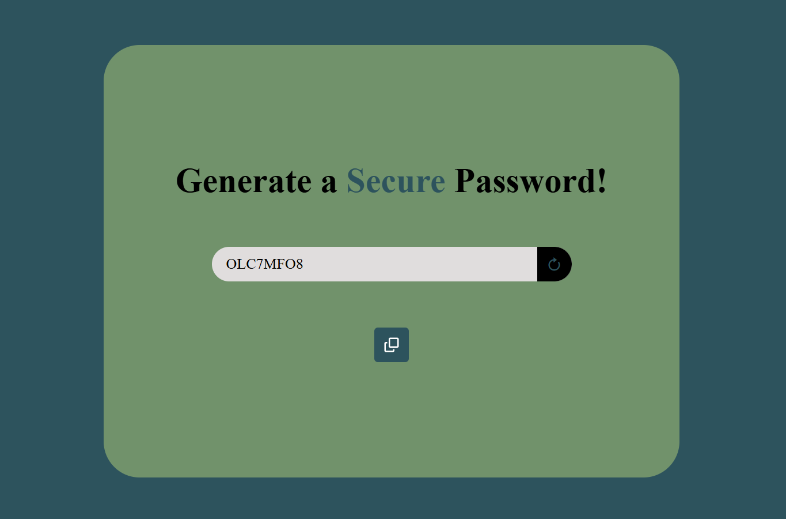

# Random Password Generator

A simple random password generator built with HTML, CSS, and JavaScript. Generate passwords with uppercase letters, lowercase letters, and numbers, and copy them to your clipboard with a single click.

## Screenshot



## Features

- Generate random 8-character passwords.
- Copy passwords to the clipboard.
- Visual feedback when a password is copied.
- Responsive design.

## Built With

- HTML5
- CSS3
- JavaScript

## Getting Started

1. Clone the repository:
   ```bash
   git clone https://github.com/oussama-dalhi/password-generator.git
   ```
2. Open `index.html` in your browser, or use VS Code Live Server.

## License

This project was built for learning purposes.